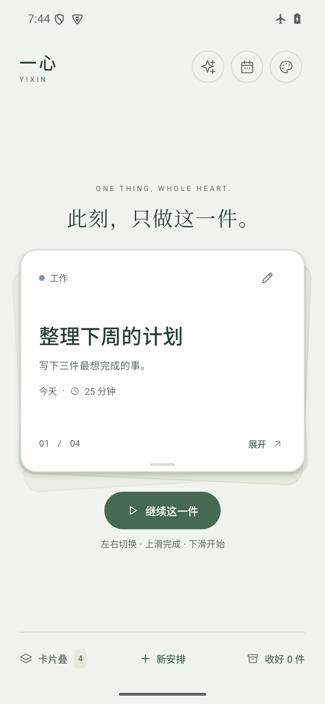
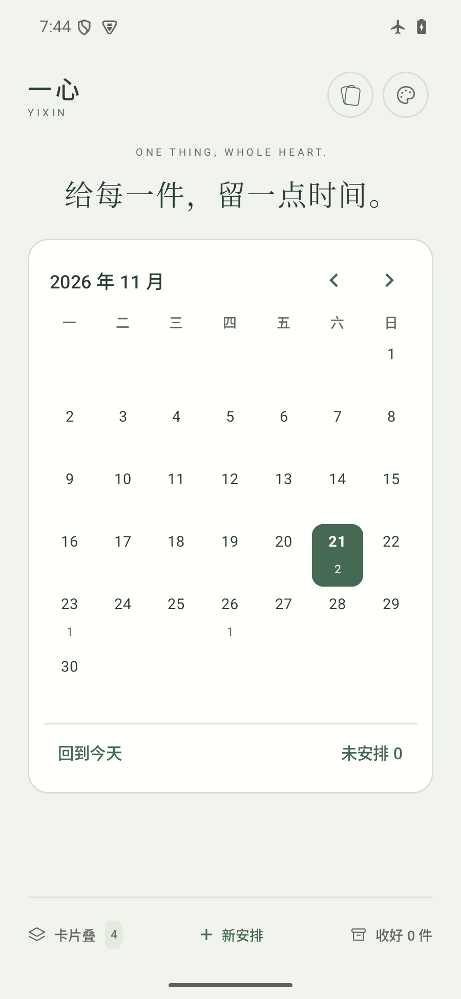
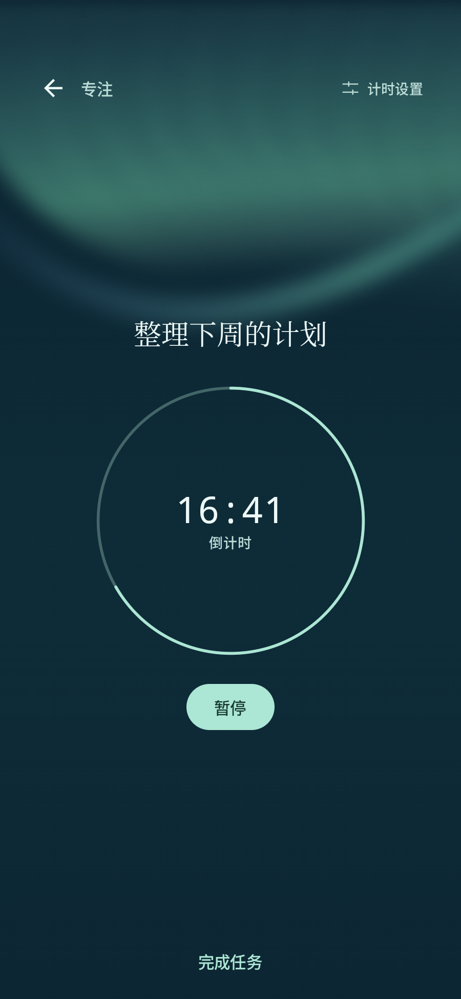

# 一心 · Android

## 项目介绍

一心是一款离线待办与专注计时应用。主界面一次展示一张任务卡片，左右滑动即可切换。也可以打开日历，点日期查看当天的待办。

- 用「新安排」添加任务，在「卡片叠」查看和排序待办，在「收好」查看完成记录。
- 从任务中直接进入专注。支持正计时、倒计时和横竖屏，暂停进度按任务保留。
- 任务、设置和计时进度保存在本机。支持导出 JSON 备份，也可以导入网页端的备份。

应用使用 Kotlin、Jetpack Compose 和 Room，支持 Android 8.0（API 26）及以上。

### 界面截图

| 卡片视图 | 日历视图 | 专注计时 |
| --- | --- | --- |
|  |  |  |

## 开发指南

### 环境准备

- JDK 17
- Android SDK Platform 35
- Android SDK Build Tools 35.0.0

### 本地运行

```sh
git clone https://github.com/SenLief/yixin.git
cd yixin
```

用 Android Studio 打开仓库根目录，选择 `app` 并在模拟器或设备上运行。也可以设置 `JAVA_HOME` 和 `ANDROID_HOME`，从命令行构建并安装。

```sh
./gradlew :app:assembleDebug
adb install -r app/build/outputs/apk/debug/app-debug.apk
```

### 测试

```sh
./gradlew :core:jvmTest :app:lintDebug
```

Room 和界面测试会写入测试数据，请使用专用模拟器或测试设备。

```sh
./gradlew :data:connectedDebugAndroidTest :app:connectedDebugAndroidTest
```

### CI 构建

每次推送 `main` 都会生成带构建编号的 Beta APK，例如 `0.0.2-beta.1-build.8`，并发布到 GitHub Releases 的预发行区。Android 内部的 `versionCode` 随 Actions 构建编号递增。

覆盖安装还要求签名一致。通过 Actions Secrets 配置并沿用同一份发布密钥，即可在后续版本间覆盖安装。签名 Secrets 为空时发布的 `-debug.apk` 用于安装测试。

### 模块结构

- [`app`](app/) 包含 Compose 界面、导航和 Android 系统集成。
- [`core`](core/) 包含任务模型、排序、专注计时和备份规则。
- [`data`](data/) 实现 Room 数据库与本地持久化。
